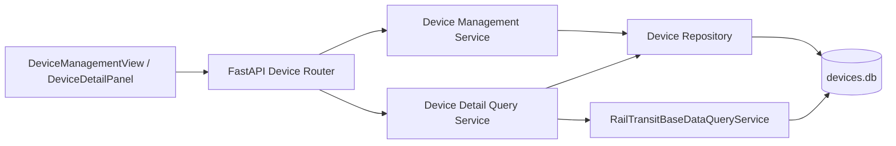

# 设备管理架构

设备管理维护 `devices.db` 中的通用设备资产、分组、凭据引用、连接和采集任务。轨道交通工程归属由 `RailTransitBaseDataQueryService` 读取 Phase 1 基础设施事实，设备管理只接收只读投影。

`device_uuid` 是唯一跨模块设备身份。设备管理页面不写 `rail_infra_*` 关系，不把线路、车站、区间或建设项目复制进设备资产。旧的 `station`、`project_phase` 和 `work_scope_status` 字段保留兼容读取，新的设备管理界面不提供工程属性维护入口。

设备列表的工程归属摘要和设备详情的工程上下文都由 Backend 生成。工程查询失败时只降级工程区域，设备列表、编辑、连接测试、采集和导入导出仍可用。
