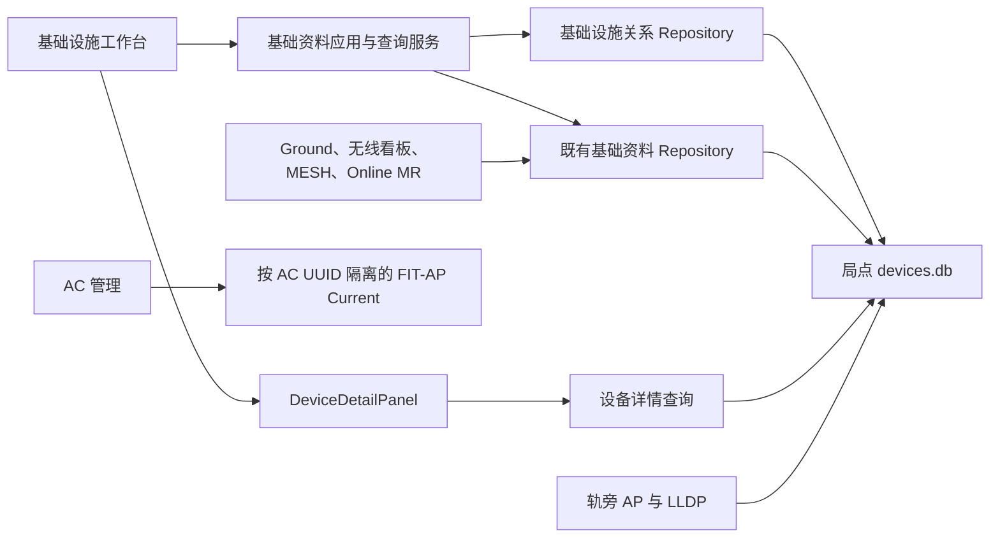

# 轨道交通基础设施架构

Phase 1 把基础设施加入现有轨道交通导航，设备管理继续承担通用资产维护。沿用局点与线路一对一的运行模型。

线路下按控制中心（COCC、BOCC）、正线车站、车辆段与停车场、车载设备组织。站点下显示正式绑定的设备，交换机下只展示有明确物理连接证据的 AP。区间属于线路拓扑，在站点详情按稳定端点引用展示。列车下显示明确建立的 CT/CW 设备关系。缺少关系时显示待配置。

设备分组保留资产管理语义。建设阶段、工程归属、调试状态、采集与统计资格属于工程上下文。旧 `project_phase`、`work_scope_status` 的现有读写继续服务各模块，变更入口前逐个验证消费者及旧数据。

车内通信检测 RETIRED。地面无人值守和无线看板保留共享列车与 MR 事实，历史任务处理器为旧记录保留兼容。
