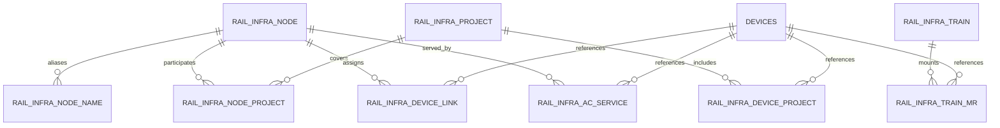

# 基础设施数据模型

每个 Site 的 `devices.db` 保存该线路的工程实体及关联。设备资产继续引用同库 `device_uuid`。现有车站复用正式 `node_uid` 作为 `station_uid`，名称及编号可独立变化。新节点在创建时分配不可变 ID。

| 表 | 主键与约束 |
| --- | --- |
| `rail_infra_node` | `node_uid`。类型区分主线车站、车辆段、停车场、COCC、BOCC。编号独立，正式名用于显示。 |
| `rail_infra_node_name` | `name_id`。按节点记录工程或历史名称、来源、生效和失效时间。 |
| `rail_infra_project` | `project_id`。阶段为项目属性。 |
| `rail_infra_node_project` | `(node_uid, project_id)`。同一站可加入多个项目。 |
| `rail_infra_device_project` | `(device_uuid, project_id)`。独立维护调试阶段、工程状态、采集和统计资格。 |
| `rail_infra_device_link` | `(node_uid, device_uuid)`。描述工程归属、角色及可选区间引用。 |
| `rail_infra_device_section` | `(device_uuid, section_uid)`。独立表达一个设备服务多个区间，安装位置和工程角色不覆盖物理节点归属。 |
| `rail_infra_ac_service` | `(ac_device_uuid, node_uid)`。AC 工程资产归属与服务站点各自维护。 |
| `rail_infra_train` | `train_uid`。线路内列车编号唯一且可更名。 |
| `rail_infra_train_mr` | `assignment_id`。同一列车端位与同一 MR 各自只有一个生效关联，结束时间保留历史。 |
| `rail_infra_relation_history` | `event_id`。关系生命周期事件、前后快照、生效时间、原因、操作者和 revision。 |
| `rail_infra_relation_audit` | `audit_id`。按局点记录 Application Service 请求审计，不删除历史业务证据。 |

端口接入、AP 工程点位和 FIT-AP Current 分别使用既有轨旁 AP、LLDP、AP Identity 和 AC 事实。没有经过确认的交换机归属、端口及 AP 身份时保留未配置或冲突状态。历史 MR 会话继续用写入时的设备和会话身份追溯。

## Phase 3 Schema 2

新增 `rail_infra_relation_state`，以不透明 relation_id 保存生命周期元数据，不替代正式关系事实。关系事件与请求审计同事务提交；复合 ID 使用 JSON 数组编码，MR 使用 assignment_id。物理安装节点与多区间服务范围独立。工程节点、项目和列车的变更，以及关系事实/历史，推进既有 base_data_revision。

迁移、时间和并发细则见 [写入契约](RELATIONSHIP_WRITE_CONTRACT.md) 与 [历史语义](RELATIONSHIP_HISTORY.md)。
