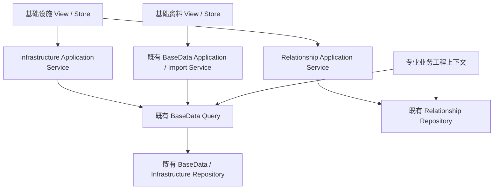

# 基础设施与基础资料独立模块

轨道交通一级菜单下，基础设施、基础资料为并列二级模块，随后是 Wireless、Ground、轨旁 AP、MESH、Online MR。没有共享主页面或通过 Tab 区分两个模块。

| 契约 | 基础设施 | 基础资料 |
| --- | --- | --- |
| Navigation ID | rail.infrastructure | rail.base-data |
| Route name | rail-transit-infrastructure | rail-transit-base-data |
| Route path | /rail-transit/infrastructure | /rail-transit/base-data |
| 模块 Feature | module.rail_infrastructure | module.rail_base_data |
| 写 Feature | capability.rail_infrastructure.write | capability.rail_base_data.write |
| 页面 | RailTransitInfrastructureView.vue | RailTransitBaseDataView.vue |
| Pinia ID | rail-transit-infrastructure | rail-transit-base-data |

两模块只共用 internal.rail_base_data 低层服务能力，不继承对方可见模块权限。Full/Customer 配置均显式登记独立 Feature；沿用各版本受控写入可见性策略。基础设施独立查询路径不需要基础资料模块开启。原工程查询 `/api/rail-transit/base-data/infrastructure` 保留兼容，但同时要求两个模块权限，新客户端使用 `/api/rail-transit/infrastructure`。

Renderer 不接触数据库；新增 Application Service 只组合正式查询，不添加持久化事实。设备详情复用 DeviceDetailPanel，下挂 AP 仍由 Trackside 正式查询提供。工程关系保持既有原子事务、幂等、revision/确认/审计/历史，不新增第二套关系写入。

旧基础资料导航、9个 Tab、导入/预览/审计/导出及编辑锁沿用原实现。基础资料仍经正式 BaseData Application Service 维护共享实体和基础字段；工程关系仅经 Relationship Application Service 维护。两模块共用同一稳定 ID 与数据库，不复制站点、资产、项目或关系表。新增基础资料 HTTP 写权限检查，防止模块权限变化后启动时授权状态被误用。

本轮不改 Schema、不迁移、不重建数据、不连接设备。基础设施节点错误显示明确不可用并清除旧选中；基础资料 URL `tab` 与基础设施 `node_uid` 分别解释。关闭一个模块时其页面及 API 拒绝，另一模块仍可独立使用；共享底层查询不受前端菜单关闭影响。

工作区按独立 route name/identity/cache key 管理标签。基础资料普通重新进入保持原总览行为；明确 `?tab=` 书签（包括页面刷新）优先于旧工作区快照。基础设施节点选择在自己的 Pinia 中保留，不污染基础资料筛选或草稿。

Electron现有工作区只在进程内保存：页面刷新可以恢复内存快照；完整退出后冷启动回到Dashboard，不持久恢复旧标签。本轮保持这一既有契约，重启后两个独立入口和显式深链接仍可访问。不能把页面刷新恢复写成冷启动持久恢复。
