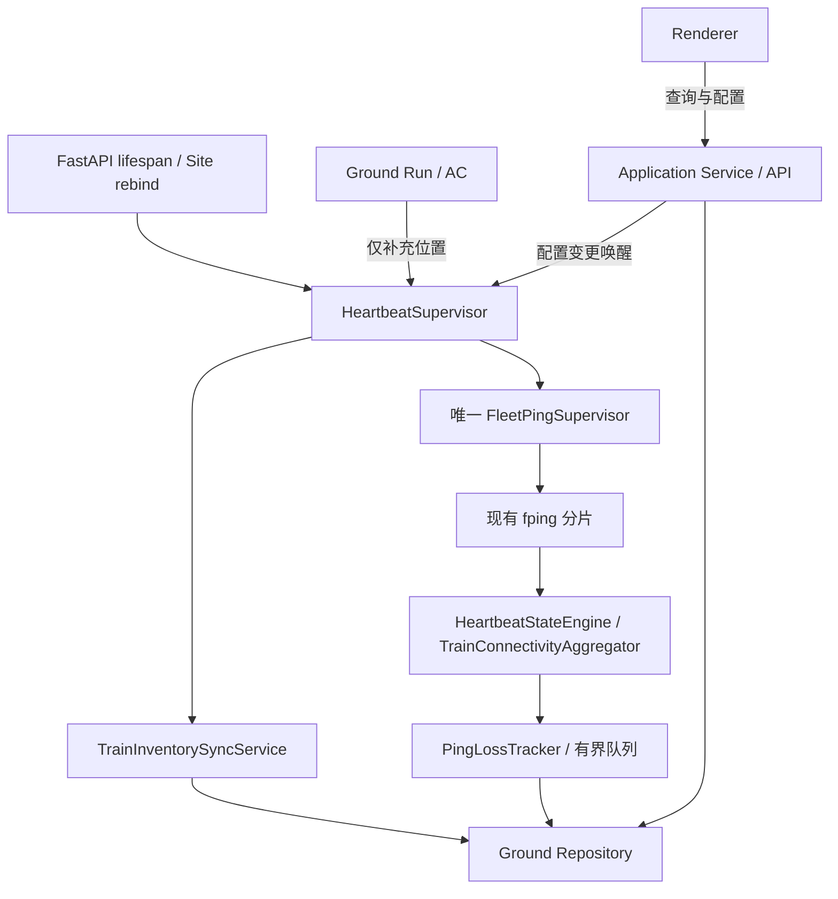

# R2.2 Heartbeat 常驻架构

日期：2026-11-10。状态：已实施，最终验收 PARTIAL；风险 L4（Backend 生命周期、持久化迁移与共享 Fleet 消费者）。

## 生命周期

FastAPI 现有 Site 组合根创建 Ground 与 Heartbeat；lifespan 显式启动/关闭 Heartbeat。Heartbeat 拥有独立线程、停止信号、配置唤醒和异常退避。Ground 保留同一 Fleet 引用供 DeepScheduler 查询，不拥有它的启动/停止。无 Run、暂停、停止、计划结束或 Run ERROR 均不终止探测。Site 切换关闭旧 Site 的 Heartbeat，关闭失败不发布新组合根。

## 库存、状态与历史

- MR 身份来自持久化轨交库存；AC、Mesh、SSH 凭据、Ping 成功与页面加载均不是库存前提。每 5 秒检查基础资料变化，失败保留上次已验证目标并显示 degraded。
- 复用现有状态引擎、车辆聚合和丢包跟踪。相同 IP 去重；跨 MR 身份冲突地址停止探测并记录冲突。库存删除不删除历史。
- 稳定流标识 `heartbeat-resident` 用于复用已有存储契约，不创建伪 Ground Run。旧 Run 历史查询保留；当前页面和 MR 查询使用常驻流。常驻 raw 位于局点 Ground 根的 `heartbeat/fleet_ping`，不进入每日 Ground Run 归档生命周期。
- 一次性事务迁移采用各实体最新旧快照及 heartbeat 丢包事件，保留原 Run 数据。迁移标记与数据一起提交；清空后不重新迁入旧事实。恢复计数、最近成功时间和未闭合丢包事件，停机空窗不生成伪造 Ping 失败。
- 显式清理必须先独立停用 Heartbeat，等待 worker 排空；仅保存 `enabled=false` 不足以允许清理。历史清理沿用既有动作与审计。

## 配置与并发

独立 `ground_unattended_heartbeat_config` 表按 Site 保存 JSON。首次启动以 INSERT OR IGNORE 固化原 Profile Fleet 参数，避免覆盖并发保存；后续 Ground Profile 不再控制常驻 Ping。配置包括启用、间隔、超时、包长、分片大小、预热及主备策略。热更新复用 Supervisor，先停止旧分片再启动新参数。

Fleet 锁先于状态锁；状态回调仅更新状态/有界队列，SQLite 状态批量写在调度线程执行。快照轮转批次 256、事件队列容量 4096；失败批次保留等待重试。Fleet 汇总失败保留 dirty bucket；仅新增/重新加入目标恢复历史汇总。

API 新增 `GET/PUT /heartbeat/config` 与 `GET /heartbeat/runtime`（均在既有 Ground Router 前缀下）；沿用库存管理 capability。Renderer 仅查询与提交独立配置，页面卸载取消自身轮询，不控制后台资源。

## 故障边界与消费者

Heartbeat tick 异常指数退避（上限 30 秒）；fping 分片异常及意外流结束均退避重建；通过 `HEARTBEAT_DEGRADED` 暴露采样、库存或持久化异常。Ground AC、Mesh、UDP、重放、深度采集失败与 Heartbeat 线程隔离，但仍共享同一 Backend 进程和 SQLite/磁盘，进程崩溃、资源耗尽及跨进程互斥未由本轮解决。

消费者审计及兼容性见 [实施前审计](R2_2_HEARTBEAT_AUDIT.md)。Syslog 批次/所有权代码未修改；raw 查询、DeepScheduler、运行健康和 Ground 收口已针对同一 Fleet 消费方式适配。最终集成门禁与缺口见 [测试报告](R2_2_TEST_REPORT.md)。
