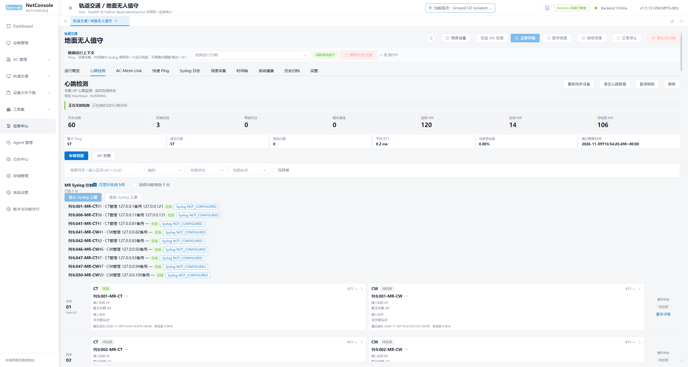
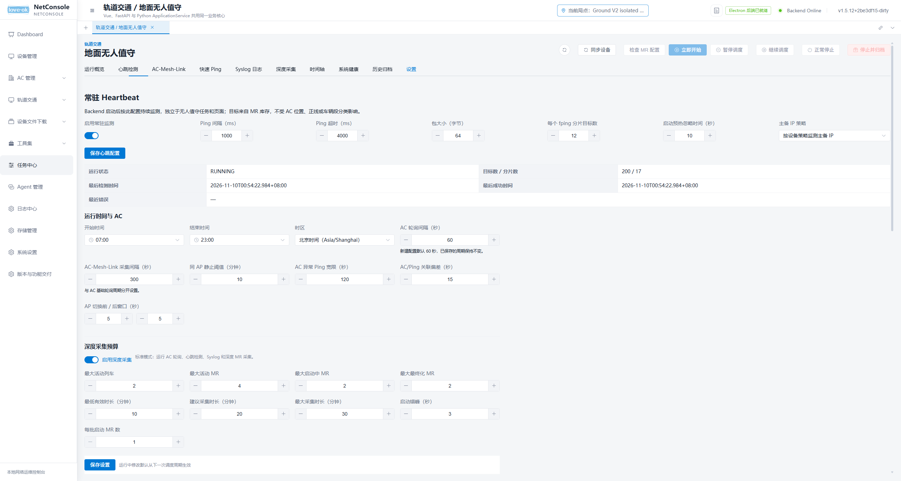
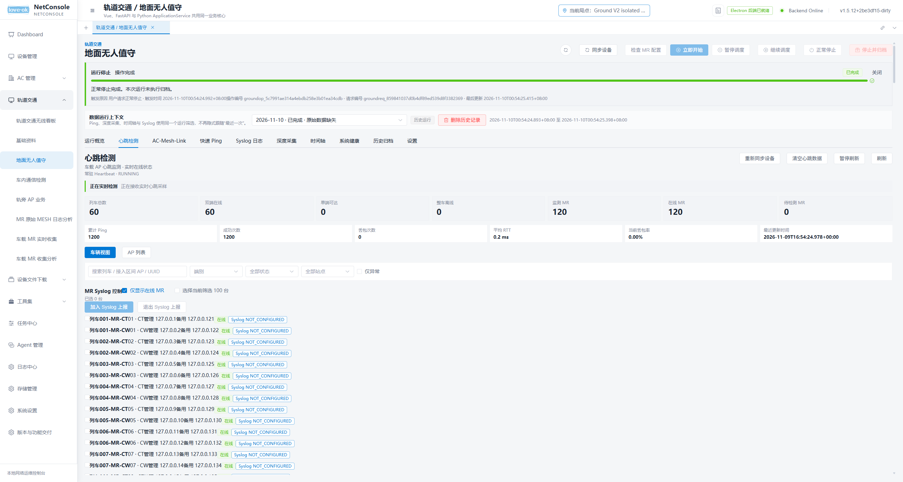
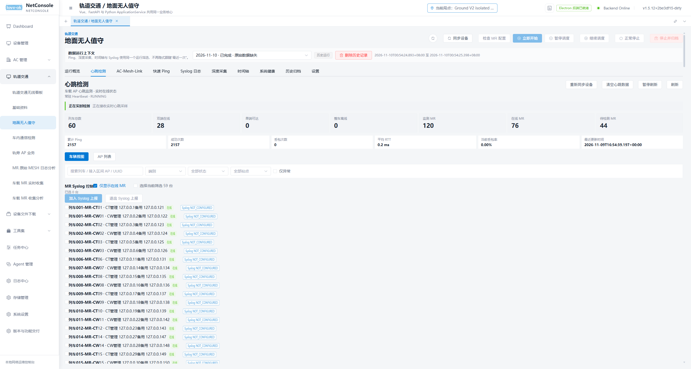

# R2.2 真实 Electron GUI 验收

日期：2026-11-10。结论：本表所列隔离场景 PASS；全面 GUI/长时交互仍 PARTIAL。

真实源码 Electron、托管 Python Backend、bundled fping、Vite Renderer；使用合成 60 车辆、120 MR、200 loopback IP。隔离根标识 `r2-2-gui-20261110-005412`。没有读取真实开发数据或访问现场设备。截图来自实际 Electron 页面；[摘要](evidence/r2-2/gui-summary.json)包含 API 观测及退出/完整性结果。

| 场景 | 结果 / 证据 |
| --- | --- |
| 无 Run、打开 Heartbeat 前已开始采样 | RUNNING、200 目标、17 分片；页面显示 60 车辆/120 MR，无 Mesh 位置仍有库存 |
| 离开页面到设备模块 | last_sample_at 从 00:54:22.984 推进至 00:54:23.977 |
| Renderer reload | 00:54:24.848 继续采样，Backend 保持 RUNNING |
| 启动/停止合成 Ground Run | 停止后仍 RUNNING、200 目标、17 分片；未启用深度采集或设备写入 |
| Electron/Backend 正常退出再启动同一隔离根 | 120 MR/200 目标恢复，累计 sent 1400 → 2058，last_sample_at 推进 |
| 正常收口 | exit 0、无所属进程残留、所查 SQLite 完整性均 ok |

第一帧 Backend readiness 后可能尚为 STOPPED；harness 等待采样后才导航/截屏，不能把进程 ready 等同于已收到首个 Ping。

## 截图

无 Run 的实际 Heartbeat 页面：

独立 Heartbeat 设置：

Ground 停止后继续运行：

Backend 重启后恢复：

## 限制

未执行真实 Renderer 进程强制退出、长时间/高频导航、GUI 逐项编辑与启停交互、不同 DPI 和窗口尺寸验收。配置热更新/启停由 API/组件自动化验证。截图早于父页面最后一处范围提示文案修正，后续修改仅更新提示文本并通过页面回归；没有宣称最终像素完全复验。Backend 重启为正常收口后的重启，不是断电/强杀崩溃恢复。
