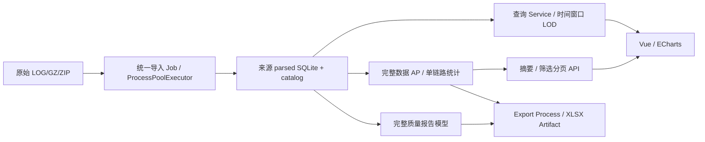

# Mesh 架构与消费者审计

日期：2026-11-08
分支：`codex-A/mesh-analysis-performance-optimization`
对照基线：`37b0df95a3208d0d03380e76ccfe5419af1422f1`

## 瓶颈与处理

| 范围 | 审计发现 | 本次处理与边界 |
|---|---|---|
| Parser | 现有并行解析，返回 records 列表 | 保留；未重写解析器、格式或 Worker 数量，解析内存仍随记录数增长 |
| Peer 质量 | 每个 Peer 重扫全部 segments/switches/flap | 一次建立 segments_by_peer、switch_in/out、flap 索引；保留 Radio 与跨 Radio flap 的旧计数语义 |
| AP 统计 | 旧 API 有 Peer 回退、非 ACTIVE 数据 | 新增独立物理 AP API；旧 ap-statistics 契约保留 |
| SQLite | 报告/建链顺序仍物化；已有分页和索引 | 业务统计明确列游标；聚合结果用 SQLite json_each 做筛选排序分页；未声称原始 SQL 聚合 |
| Excel | write_only/constant_memory 已存在，上游模型仍全量 | 复用 writer，默认业务列，诊断列可选；独立明细游标读取，新增统计也读取完整来源 |
| 图表 | 完整首开默认 full，大来源传输过多 | <=50k full，大/未知 overview；局部窗口 high，显式 full 保留 |

## L4 Consumer Audit

风险最高为 L4：新增 Feature Registry capability；公共 DTO、导出文件契约为 L3。没有 schema 迁移、共享 Identity resolver 重写或 Electron runtime 修改。

| 消费层 | 当前实现 / 审计结果 | 回归 |
|---|---|---|
| 写入 | Parser/导入/catalog/identity remap 原链保留；局点参数继续原子 site_meta 保存 | 全量 Python、Mesh 数据契约 |
| 读取 | 新 Service 只读来源 SQLite；缺 optional identity/metrics 列兼容；原 API 保留 | business_statistics、web_api、query_service |
| 缓存 | 单 session，DB/WAL 元数据、来源、有效规则/参数、身份 snapshot 参与 key；>=10k 风险区段不缓存 | 失效与只读测试 |
| 展示 | FeatureGate、新七卡；点击后服务端分页；Abort/generation；失败保留有效内容 | Summary、View behavior、API、loading policy |
| 导出 | 创建前校验冻结有效参数/身份 snapshot；复用现有固定动作、Save As、Artifact 协调器与 Export Process | report、export、user-file contracts |
| 旧格式 | 无新 migration；缺物理 MAC 进入未识别；历史 explicit physical projection 可读；冲突拒绝归并 | 旧 optional schema、alias conflict、原始导出测试 |
| 平台消费者 | Feature snapshot/Full/Customer、i18n、导航；共享表格与图表实现未改 | local_gate full 的 Renderer/Electron/architecture/platform suites |
| 并行修改 | 续跑核对仅此 worktree；当前 dirty 均为本专项，未发现其它 worktree 的同路径写入 | 最终 status/diff 核对 |
| 最终集成 | 本任务只本地提交，不合并 main | 未来合并后的准确 commit 必须重跑 full gate；分支结果不能替代合并门 |

主要修改位于 Mesh 质量/统计/报告/导出、参数 DTO/Application/API、Vue Mesh 页面/组件/API/i18n、Feature Registry、对应测试及基准脚本。完整文件清单由最终 Git commit 可追踪。

内存边界：完整 quality/report、建链列表、AP histogram、未识别身份缓存和风险区段仍物化；histogram 随不同 RSSI 值、风险随区段数增长。没有实现全链路恒定内存，也没有重复引入进程架构或大型依赖。
